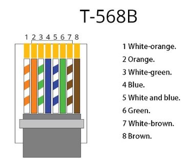
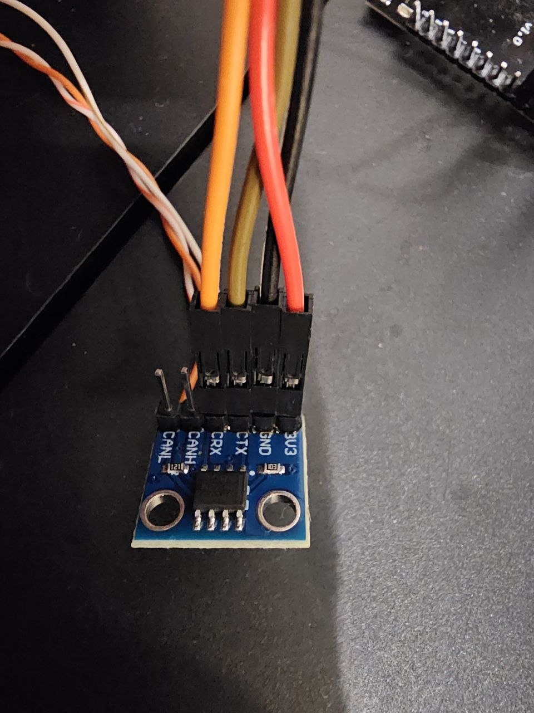
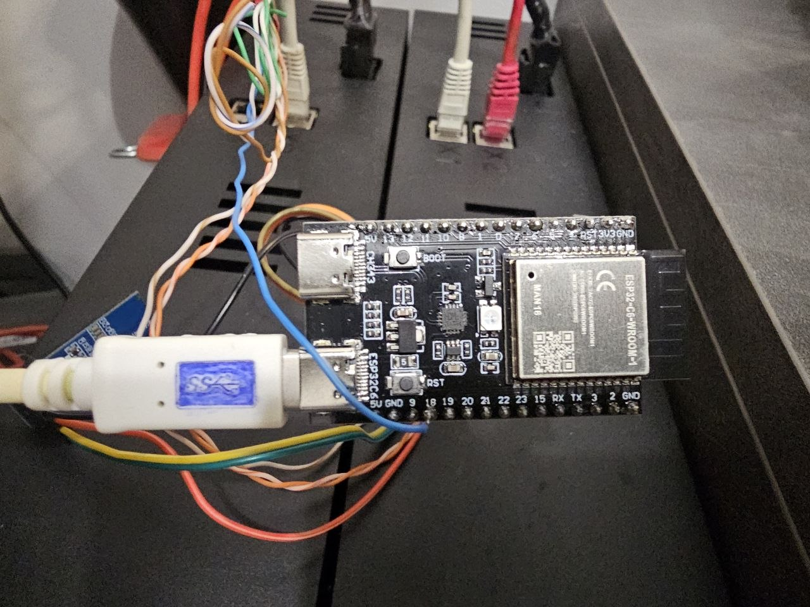

# CAN monitoring for Lifepo4 batteries BMZ 618031 with ESP32-C6

This might be useful for anyone who owns these batteries and wants to get at least some data out of them. In my case, I have an EcoFlow Delta 2 Max and two LiFePO4 BMZ 618031 batteries, connected via an A25F-50A cable (mine is probably from AliExpress — details on how the cable hack works [here](https://www.reddit.com/r/Ecoflow_community/comments/1mn4bh6/delta_3_plus_eb_port_hack_charging_discharging/)). The whole setup is far from officially supported, yet it works: during charging, the EcoFlow brings these batteries up to a 93–96% charge level. I haven't tested a full discharge yet, so I can't speak to that part, but so far it's working well.

Firmware for an ESP32-C6-WROOM-1 that monitors BMZ 618031 LiFePO4 ESS
battery modules over CAN: live web dashboard, history graphs, raw CAN
sniffer, remote log viewer, and browser-based OTA updates — everything
over WiFi, no USB needed day to day.


## Setup

Two 618031 modules, connected to an **EcoFlow Delta 2 Max** via an
unofficial **A25F-50A** extension cable (the cheapest way to add capacity
to that unit). The ESP32 taps the CAN bus between the two battery modules.

## Hardware

- ESP32-C6-WROOM-1
- WCMCU-230 CAN transceiver (NSi1050): CTX→GPIO20, CRX→GPIO19, 3V3/GND→board
- 0.91" SSD1306 I2C OLED: SDA→GPIO6, SCL→GPIO7, VCC/GND→board
- Battery **Enable** line → GPIO18 (see below — required, not optional)

### Wiring (RJ45, T-568B colors)

| Pin | Color | Signal |
|---|---|---|
| 1 | white/orange | CAN H |
| 2 | orange | CAN L |
| 4 | blue | **Enable** (drive 3.3V to wake the battery's comms section — it's unpowered otherwise, regardless of CAN wiring) |
| 7 | white/brown | GND |



Pins 3/5/6/8 unused. This unit's connector does **not** match the generic
Victron Type A/B "CAN-bus BMS" cable pinout — trace from the battery's own
transceiver chip if in doubt.




## Protocol

**Not** Victron's "CAN-bus BMS" protocol (the initial assumption, despite
Victron's own BMZ-ESS compatibility notes) — real traffic uses a different,
node-addressed scheme: `id = base + node`, one node per physical battery
module. See `src/protocol/bmz_can.cpp` for the decoder and
`battery_status.h` for per-field confidence notes (several byte layouts
are community-reverse-engineered, not from an official datasheet).

| Base | Contents |
|---|---|
| `0xC0` | Heartbeat (byte 0 == 1) |
| `0x80` | Second heartbeat-like frame, purpose unconfirmed |
| `0x100` | Bytes 0-3 fault bits, byte 5 main relay (1=closed) |
| `0x140` | Min/max cell voltage (bytes 0-1/2-3) + BMS status flags (4-5) |
| `0x180` | 3x board temperature (NTC 1-3) |
| `0x1C0` | Bytes 2-3: charge/discharge power, watts (×0.1 — confirmed by cross-checking a real ~1300W charging session). Bytes 4/5: two SOC candidates, both exposed since neither is confirmed authoritative |
| `0x200`/`0x240`/`0x280`/`0x2C0` | Cell voltages 1-4/5-8/9-12/13-16 (pack voltage = sum) |
| `0x300` | 6x cell temperature, 1 byte each |
| `0x380` | Bytes 0-1: current limit (×0.1A, confirmed ~28.7A). Bytes 2-3: unknown, confirmed not capacity |
| `0x3C0` | Bytes 0-3: presumed balancing bitmask. Bytes 4-5: undecoded |
| `0x6C0` | Serial/firmware (raw bytes) + readiness phase (byte 4: 0=warming up) |

No GX/inverter-style keep-alive appears to be required — each module
broadcasts continuously once Enable is driven. A `0x305` keep-alive
transmitter exists (`/settings`, off by default) in case long-run testing
proves otherwise.

## Building / flashing

Requires [PlatformIO](https://platformio.org/install/cli) (`pip install
platformio`, or the VS Code extension).

```
pio run                      # build
pio run -t upload            # flash over USB
```

Once on WiFi, reflash entirely remotely: `curl -F firmware=@firmware.bin
http://<device-ip>/update`.

First boot with no saved WiFi starts an AP `BMZ-Monitor-Setup` — connect
and open `http://192.168.4.1/settings` to configure WiFi.

## Web portal

`/` dashboard · `/can` raw frame sniffer · `/logs` live firmware logs ·
`/settings` · `/update` OTA


## Safety

Reverse-engineered protocol, used at your own risk. The documented failure
mode for a wrong keep-alive/wake sequence is safe (battery just disables
output), but this is not an official integration — verify anything
load-bearing against `/can` before trusting it operationally.
